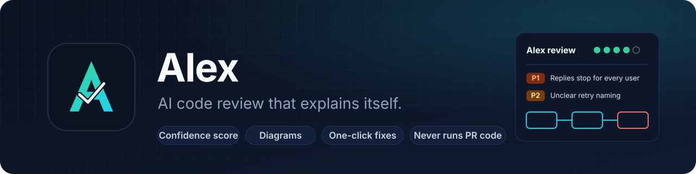
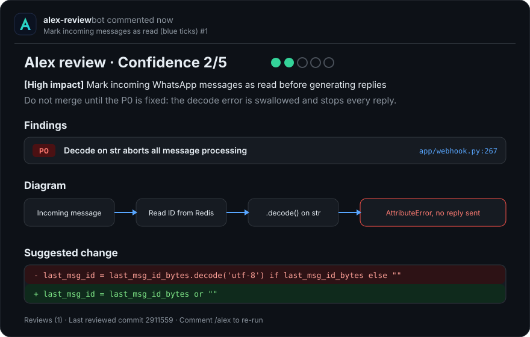
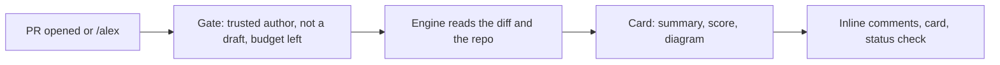

<p align="center">
  
</p>

<h1 align="center">Alex</h1>

<p align="center">
  <b>An AI pull request reviewer that reads like a senior engineer.</b><br>
  A verdict you can read in five seconds, and the exact fix in thirty.
</p>

<p align="center">
  
  
  
  
  
  
</p>

---

## Table of contents

1. [About](#about)
2. [Features](#features)
3. [What a review looks like](#what-a-review-looks-like)
4. [How it works](#how-it-works)
5. [Install](#install)
6. [Usage](#usage)
7. [Configuration](#configuration)
8. [Run the tests](#run-the-tests)
9. [Roadmap](#roadmap)
10. [Contributing](#contributing)
11. [Credits](#credits)
12. [License](#license)

## About

**The problem.** Code review is slow, and most AI reviewers bury the one real bug under a wall of
style notes. Teams that want a clear "can I merge this?" answer pay for tools like Greptile.

**What Alex is.** Alex reviews every pull request and posts three things: a summary card with a
confidence score and a diagram, inline comments on the exact lines with one-click fixes, and a
status check on the commit. The goal is to match Greptile's paid (Pro) plan feature by feature.

**Why it is built this way.**

- **Safe on untrusted code.** Alex reads PR code as git objects and never runs it.
- **Scores you can trust.** The confidence score is the model's judgment inside hard limits, so it
  can never contradict the findings.
- **Nothing to install.** The review logic is Python standard library only, so there is nothing to break on a runner.
- **Measured, not promised.** Each phase is compared side by side with Greptile on a
  [lab repo](https://github.com/niihhhall/mark-ai-review-lab) of real historical bugs.

**Challenges so far.** Keeping the summary about the change instead of restating findings, and
keeping Mermaid diagrams valid. Every diagram line is now checked against an allowed grammar, a
missing diagram gets one retry, and a broken one is dropped instead of posted. Notes are in
[docs/comparisons/phase-1.md](docs/comparisons/phase-1.md).

## Features

- **Summary card**: impact, merge verdict, confidence 0 to 5, numbered findings, file breakdown, diagram, review counter. Updated in place on every re-review.
- **Inline comments**: 🔴 P0, 🟠 P1 and 🟡 P2 badges on the exact line, with a **Commit suggestion** fix. Never posted twice.
- **Status check**: `Alex review · Confidence 4/5 · 1 P1`. Can block merging while a P0 is open.
- **Triggers**: reviews new pull requests automatically; comment `/alex` to review again.
- **Reactions**: 👀 when Alex starts, 👍 when the review is posted, 😕 when it fails.
- **Safety locks**: trusted authors only (owner, member, collaborator), signed webhooks, account allowlist, per-review and monthly token caps.

## What a review looks like

<p align="center">
  
</p>

| Findings | Highest score allowed |
|---|---|
| any P0 | 2 |
| two or more P1 | 3 |
| exactly one P1 | 4 |
| only P2 | 4 |
| none | 5 |

Full rules for the card, badges and diagrams: [design system](docs/design-system.md).

## How it works



Alex checks out the **base branch** and reads PR code as git objects. It never runs code from the PR.

## Install

### Option 1: GitHub App (recommended)

Alex runs as the **`alexreview-ai`** GitHub App, hosted on Render ([deploy guide](docs/deploy-render.md)).

1. Open GitHub **Settings → Applications → alexreview-ai → Configure**.
2. Tick the repo and **Save**. No files or secrets go into the repo.
3. Open a pull request. Alex posts as `alexreview-ai[bot]`.

### Option 2: GitHub Action

1. Copy [`examples/workflows/alex-review.yml`](examples/workflows/alex-review.yml) to `.github/workflows/alex-review.yml`.
2. Add the repo secret **`ALEX_LLM_API_KEY`**: any OpenAI-compatible key. The default endpoint is Fireworks.

<details>
<summary><b>Optional: give the Action its own bot name and avatar</b></summary>

Create a GitHub App (permissions: Contents read, Pull requests write, Issues write, Commit statuses write),
install it on your repos, then set the variable `ALEX_APP_ID` and the secret `ALEX_APP_PRIVATE_KEY`.
Use [`docs/assets/alex-logo.svg`](docs/assets/alex-logo.svg) as the avatar.
</details>

### Option 3: local development

```bash
git clone https://github.com/niihhhall/alex-mvp.git
cd alex-mvp
python -m unittest discover -s tests -v
```

Python 3.10 or newer. No packages to install.

## Usage

| Command | What it does |
|---|---|
| `/alex` | Review the PR again (after you push fixes) |
| `@alexreview-ai` | Same as `/alex` |

More commands (`/alex review this at plus`, questions, explain, tests) arrive later in phase 2.

To preview a card locally without touching GitHub:

```bash
python -m alex.main preview --ocr-json engine.json --diff pr.diff --title "PR title" --out out --no-llm
```

## Configuration

<details>
<summary><b>Action inputs</b></summary>

| Input | Default | |
|---|---|---|
| `llm_api_key` | required | API key, from a secret |
| `llm_url` | Fireworks | OpenAI-compatible base URL |
| `model` | DeepSeek V4.1 Flash | Model that finds issues |
| `card_model` | same as `model` | Model that writes the card |
| `token_budget` | `1500000` | Spending cap per review |
| `fail_on_p0` | `true` | Status check fails while a P0 is open |
| `engine_version` | `1.12.10` | Pinned engine version |
| `app_id`, `app_private_key` | empty | Optional bot identity |
</details>

Per-repo settings in a `.alex/` folder arrive in phase 2. Hosting settings are in [docs/deploy-render.md](docs/deploy-render.md).

## Run the tests

```bash
python -m unittest discover -s tests -v
```

The unit tests cover the card, scoring, inline comments, diagram grammar and the webhook server.
Every change to prompts or scoring is also re-run on the lab cases ([docs/lab-cases.md](docs/lab-cases.md)).

## Roadmap

| Phase | Scope | Status |
|---|---|---|
| **1** | Triggers, summary card, inline comments, safety gate, status check | ✅ done ([comparison](docs/comparisons/phase-1.md)) |
| **2** | GitHub App `alexreview-ai`, Render hosting, security locks, review tiers (base, plus, apex), `.alex/` config, questions | 🚧 in progress: app, hosting and locks are live |
| **3** | Security scan, auto-approve, related-repo context | planned |
| **4** | Learning from reactions and replies, analytics, CLI | planned |
| **5** | Run tests in a sandbox, codebase index | optional |

Full plan: [docs/blueprint.md](docs/blueprint.md).

<details>
<summary><b>Repository layout</b></summary>

```
alex/                 review logic: card, scoring, inline comments, GitHub client, webhook server
tests/                unit tests
action.yml            the GitHub Action
Dockerfile            image for the hosted app
render.yaml           Render services
examples/workflows/   workflow file to copy into a repo
docs/                 blueprint, design system, lab cases, comparisons, assets
evals/aacr/           AACR-Bench harness (industry benchmark)
evals/lab/            lab tooling: run the engine on a case, redact and scan snapshots
scripts/              developer helpers
```
</details>

## Contributing

Alex is an MVP built phase by phase, so issues and ideas are welcome.

1. Open an issue that describes the bug or the feature.
2. Create a branch, keep the change small, and follow [docs/engineering.md](docs/engineering.md) (standard library only, no em or en dashes in any output).
3. Run the tests, then open a pull request.

## Credits

- Built by [Nihal Mishra](https://github.com/niihhhall).
- Feature reference: [Greptile](https://www.greptile.com/), the reviewer Alex is compared against.
- Badges by [shields.io](https://shields.io/). Diagrams by [Mermaid](https://mermaid.js.org/).

## License

[MIT](LICENSE)
