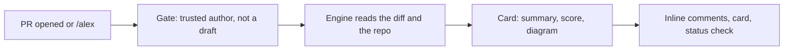

<p align="center">
  
</p>

<p align="center">
  
  
  
  
</p>

<p align="center">
  <b>Alex reviews every pull request like a senior engineer:</b><br>
  a verdict you can read in five seconds, and the exact fix in thirty.
</p>

---

## What a review looks like

<p align="center">
  
</p>

Every review posts three things:

| | |
|---|---|
| **Summary card** | Impact, merge verdict, confidence score from 0 to 5, numbered findings, file breakdown, a diagram of the change, and a review counter. Updated in place on every re-review. |
| **Inline comments** | On the exact line, with 🔴 P0, 🟠 P1 or 🟡 P2 badges and a one-click **Commit suggestion** fix. Never posted twice. |
| **Status check** | `Alex review · Confidence 4/5 · 1 P1` on the commit. Can block merging while a P0 is open. |

The confidence score is the model's judgment inside hard limits, so it can never contradict the findings:
any P0 caps it at 2, two P1s at 3, one P1 at 4. Details in the [design system](docs/design-system.md).

## How it works



Alex checks out the **base branch** and reads PR code as git objects. It never runs code from the PR,
so it is safe on untrusted changes.

## Add Alex to a repo

Alex runs as the **`alexreview-ai`** GitHub App, hosted on Render ([deploy guide](docs/deploy-render.md)).

1. GitHub **Settings → Applications → alexreview-ai → Configure**.
2. Tick the repo and **Save**. No files or secrets go into the repo.
3. Open a pull request. Alex reacts 👀, reviews, then 👍, posting as `alexreview-ai[bot]`.

<details>
<summary><b>Alternative: run Alex as a GitHub Action instead</b></summary>

1. Copy [`examples/workflows/alex-review.yml`](examples/workflows/alex-review.yml) to `.github/workflows/alex-review.yml`.
2. Add the repo secret **`ALEX_LLM_API_KEY`**: any OpenAI-compatible key. The default endpoint is Fireworks.
</details>

| Command | What it does |
|---|---|
| `/alex` | Review the PR again |

More commands (`/alex review this at plus`, questions, explain, tests) arrive in phase 2.

<details>
<summary><b>Optional: a bot with its own name and avatar</b></summary>

Create a GitHub App (permissions: Contents read, Pull requests write, Issues write, Commit statuses write),
install it on your repos, then set the variable `ALEX_APP_ID` and the secret `ALEX_APP_PRIVATE_KEY`.
Use [`docs/assets/alex-logo.svg`](docs/assets/alex-logo.svg) as the avatar.
</details>

<details>
<summary><b>Action inputs</b></summary>

| Input | Default | |
|---|---|---|
| `llm_api_key` | required | API key, from a secret |
| `llm_url` | Fireworks | OpenAI-compatible base URL |
| `model` | DeepSeek V4.1 Flash | Model that finds issues |
| `card_model` | same as `model` | Model that writes the card |
| `token_budget` | `1500000` | Spending cap per review |
| `fail_on_p0` | `true` | Status check fails while a P0 is open |
| `engine_version` | `1.12.10` | Pinned engine version |
| `app_id`, `app_private_key` | empty | Optional bot identity |
</details>

## Roadmap

Alex is built phase by phase, and each phase is compared side by side with Greptile on a
[lab repo](https://github.com/niihhhall/mark-ai-review-lab) of real historical bugs.

| Phase | Scope | |
|---|---|---|
| **1** | Triggers, summary card, inline comments, safety gate, status check | ✅ done ([comparison](docs/comparisons/phase-1.md)) |
| **2** | `@alexreview-ai` bot identity, review tiers (base, plus, apex), `.alex/` config, install anywhere, questions | planned |
| **3** | Security scan, auto-approve, related-repo context | planned |
| **4** | Learning from reactions and replies, analytics, CLI | planned |
| **5** | Run tests in a sandbox, codebase index, hosted app | optional |

Full plan: [docs/blueprint.md](docs/blueprint.md).

## Repository layout

```
alex/                 review logic: card, scoring, inline comments, GitHub client
tests/                unit tests
action.yml            the GitHub Action
examples/workflows/   workflow file to copy into a repo
docs/                 blueprint, design system, lab cases, comparisons, assets
evals/aacr/           AACR-Bench harness (industry benchmark)
evals/lab/            lab tooling: run the engine on a case, redact and scan snapshots
scripts/              developer helpers
```

## Develop

```bash
python -m unittest discover -s tests -v
python -m alex.main preview --ocr-json engine.json --diff pr.diff --title "PR title" --out out --no-llm
```

Standard library only, nothing to install. Conventions: [docs/engineering.md](docs/engineering.md).

## License

[MIT](LICENSE)
